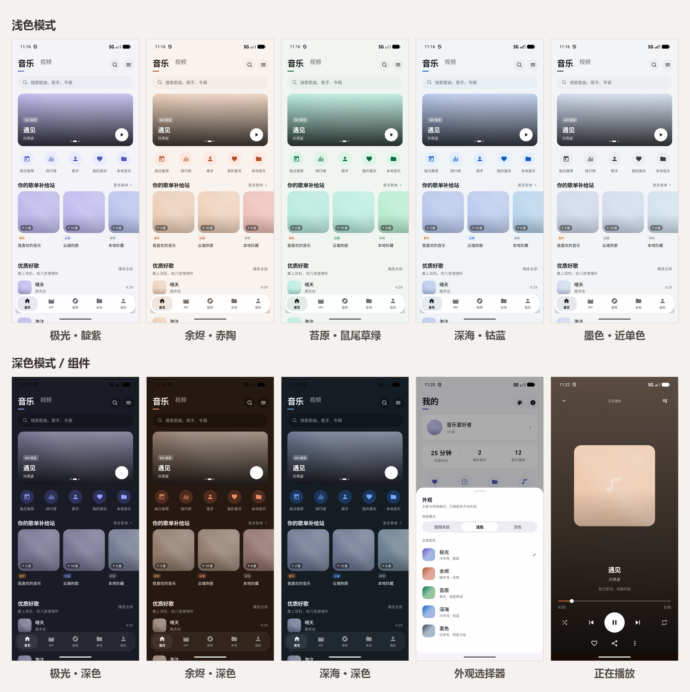

# 配色与主题系统

一句话：**颜色只写在 `values/colors_theme_*.xml` 里，组件只认 `?attr/au*`。**
想换配色就改这一层，不用动任何布局和 Kotlin。



上图是真机截图：上排 5 套浅色主题，下排深色模式、外观选择器、正在播放页。

---

## 1. 有哪几套

5 套主题 × 亮/暗 = 10 份完整色板。每套换的不只是强调色，**中性色也一起换**——
暖色品牌配冷灰会发灰，冷色品牌配暖灰会显脏，所以每套主题的中性色都带自己的色相。

| key | 名字 | 中性色 | 强调色 | 说明 |
|---|---|---|---|---|
| `aurora` | 极光 | 冷中性 | 靛紫 | App 默认身份色 |
| `ember` | 余烬 | 暖中性 | 赤陶 | 暖沙底 + 陶土红，最不像"科技产品"的一套 |
| `sage` | 苔原 | 青灰 | 鼠尾草绿 | 低彩度绿，长时间看不累 |
| `cobalt` | 深海 | 冷中性 | 钴蓝 | 最稳妥的一套，接近原来的蓝色 |
| `noir` | 墨色 | 近无彩 | 近单色 | 只靠明度分层，最有编辑感 |

亮暗模式三档：跟随系统 / 浅色 / 深色（`AppCompatDelegate.setDefaultNightMode`）。

入口：**我的 → 右上角调色板图标** → 「外观」底部弹层。

---

## 2. 语义 token（37 个）

组件里**只能**用这些名字，不准出现 `R.color.xxx`，也不准写死 `#RRGGBB`
（压在封面/视频上的那几个绝对色除外，见第 5 节）。

| 分组 | token | 用途 |
|---|---|---|
| 底 | `auCanvas` | 页面底色 |
| | `auSurface` | 卡片、弹层、导航条 |
| | `auSurfaceSunken` | 搜索框、分段控件轨道、比卡片更"凹"的底 |
| | `auSurfacePressed` | 按下态 |
| | `auHeroPlaceholder` | 大图未加载时的占位底 |
| 字 | `auInk` | 正文（对比度 ≥ 7:1） |
| | `auInkSecondary` | 次要信息（≥ 4.5:1） |
| | `auInkTertiary` | 弱提示、图标默认态（≥ 3:1） |
| | `auInkInverse` | 反色文字 |
| 品牌 | `auAccent` | 主操作、选中态（≥ 3:1） |
| | `auAccentOn` | 压在强调色上的字（≥ 4.5:1） |
| | `auAccentSoft` | 强调色的浅底（圆形图标底） |
| | `auAccentDeep` | 强调色的深色变体（按下态） |
| | `auAccentCyan` | 副强调，只在进度条渐变里出现 |
| 线 | `auHairline` | 分隔线（亮） |
| | `auHairlineDark` | 分隔线（压在深底上） |
| 遮罩 | `auScrim` | 弹层背景遮罩 |
| | `auNavPill` | 底部导航选中胶囊 |
| 深底 | `auDarkCanvas` / `auOnDark` / `auOnDarkSecondary` / `auDarkPill` | 播放页、MV 页这类"深色页面在浅色主题下也要存在"的场景 |
| 状态 | `auLike` | 红心（唯一允许的暖红，全 App 只有一处） |
| | `auSuccess` / `auWarning` / `auDanger` | 语义状态 |
| 进度 | `auProgressStart` / `auProgressMid` / `auProgressEnd` | 进度条渐变三停 |
| 标签 | `auTagBrandBg/Text`、`auTagWarmBg/Text`、`auTagNeutralBg` | 歌单角标（云端/最近/本地） |
| 色斑 | `auBlobA`–`auBlobD` | 兜底封面的取色源，也是弹层色样的来源 |

深底那一组（`auDark*`）不是多余：正在播放页永远压在封面上，
MV 页永远是深色底，它们需要一组"不跟亮暗模式变"的颜色。
如果让它们跟着 `auInk` 走，浅色模式下就会出现黑字压黑图。

---

## 3. 文件都在哪

```
app/src/main/res/
├─ values/attrs.xml                      37 个 au* 属性声明
├─ values/themes.xml                     5 个 Theme.Aurora*（亮）
├─ values-night/themes.xml               5 个 Theme.Aurora*（暗）
├─ values/colors_theme_aurora.xml        极光亮色色板
├─ values-night/colors_theme_aurora.xml  极光暗色色板
├─ values/colors_theme_{ember,sage,cobalt,noir}.xml
├─ values-night/colors_theme_{ember,sage,cobalt,noir}.xml
├─ values/colors_genre.xml               12 个曲风标签色（亮）
├─ values-night/colors_genre.xml         同上（暗）
└─ values/colors.xml                     只剩 white / black
```

`values/colors.xml` 里只剩 `white` 和 `black`，这是刻意的：
这两个是"压在封面/视频上的绝对色"，不属于主题，不该跟主题变。
任何其它颜色出现在这里都是漏改。

主题继承链：

```
Theme.Material3.DayNight.NoActionBar
└─ Theme.Aurora            (极光，App 默认)
   ├─ Theme.Aurora_Ember
   ├─ Theme.Aurora_Sage
   ├─ Theme.Aurora_Cobalt
   └─ Theme.Aurora_Noir
```

每个主题里都重新映射了 Material 自己的 `colorPrimary`、`colorSurface` 等
（指向 `@color/theme_<key>_<token>`），所以 Material 组件（按钮、弹层、开关）
会自动跟着换色，不用一个个改。

---

## 4. 改颜色 / 加颜色 / 加主题

### 改某套主题的某个颜色

只改 `values/colors_theme_<key>.xml` 和 `values-night/colors_theme_<key>.xml`
里的 `<color name="theme_<key>_<token>">`。组件不用动——它们引的是 `?attr`。

> 色板不是手调的，是 `tools/theme/gen_palette.py` 用 OKLCH 算出来的。
> 想系统性调，改脚本里的 `THEMES[...]` 再重新生成，别在 XML 里一个个试。

### 加一个新 token

1. `values/attrs.xml` 加 `<attr name="auFoo" format="color" />`
2. 10 份 `colors_theme_*.xml` 各加一个同名 color
3. 10 份 `themes.xml` 各加一行 `<item name="auFoo">@color/theme_<key>_foo</item>`
4. 跑一次 `gen_palette.py` 的对比度校验，确认新色没把可读性打下去

### 加一套新主题

1. `tools/theme/gen_palette.py` 的 `THEMES` 里加一项（中性色相、强调色相、彩度、明度、4 个色斑）
2. 重新生成到 `res/`
3. `ui/theme/ThemeManager.kt` 的 `AuroraTheme` 枚举加一项
4. `strings.xml` 加 `theme_<key>` 和 `theme_<key>_note`
5. 弹层会自动多出一行（列表是遍历枚举生成的）

---

## 5. 硬规则

1. **一个界面只有一个品牌色相。** 例外只有两处：曲风标签（12 色，是内容不是品牌）
   和 `auLike` 的红心（唯一语义红）。
2. **中性色不许是无彩灰。** 每套主题的中性色都带 0.004–0.013 的彩度，
   纯灰(`R=G=B`)在这个 App 里是 bug。
3. **彩度随明度收。** 越接近白或黑，彩度越低；中间调彩度最高。
   这条决定"高级感"——彩度平铺的色板一定显廉价。
4. **深色不是反色。** 深色模式的强调色明度 +0.15、彩度 ×0.85，
   不是简单地把浅色反转。
5. **对比度是硬门槛**，不是建议值：正文 7:1、次要 4.5:1、弱提示 3:1、
   控件边界 3:1。`gen_palette.py` 会跑 160 组配对，全过才算数。
6. **面积配比 60/30/10**：中性 60、卡片/层次 30、品牌色 10。
   品牌色一旦超过 10%，界面就开始"喊"。
7. **兜底封面跟着主题走。** `CoverArt.configure()` 用当前主题的 `auAccent`
   生成整块色板（色相只动 ±8°，区分靠明度）。写死彩虹色板会让页面上出现
   "紫色按钮配一屏青色封面"的拼盘感——这是最容易翻车的地方。
8. **深色下封面压到中低明度。** 深底上放接近白的大色块会直接抢掉整个界面，
   所以 `CoverArt` 在夜间把明度压到 0.56 以下。
9. **R.color 在 Kotlin 里绝迹。** 自绘控件用 `Context.themeColor(R.attr.auXxx)`。

---

## 6. 已校验的对比度

`tools/theme/gen_palette.py` 输出 160 组配对，当前全部通过。门限：

| 配对 | 门限 |
|---|---|
| `ink` / `canvas` | 7.0 |
| `ink_secondary` / `canvas` | 4.5 |
| `ink_tertiary` / `canvas` | 3.0 |
| `accent_on` / `accent` | 4.5 |
| `accent` / `canvas` | 3.0 |
| `auOnDark` / `auDarkCanvas` | 7.0 |
| 标签文字 / 标签底 | 4.5 |
| `hairline` / `surface` | 1.15 |
| `surface_pressed` / `surface` | 1.15 |

改完色板重跑：

```bash
python tools/theme/gen_palette.py --out app/src/main/res --json tokens.json
```

脚本会打印每一条配对的实际比值，任一失败就以非 0 退出。

---

## 7. 已知取舍

- **深色模式不做纯黑。** 画布明度 0.225（约 `#1E1E22`），不是 `#000`。
  纯黑在 OLED 上会让阴影和卡片层次全部消失，而且白字反差过大反而刺眼。
- **正在播放页在浅色主题下也是深色。** 它压在封面图上，浅底会让白字失效。
  这不是"没做完深色模式"，是刻意的：用 `auDark*` 那一组固定色。
- **封面占位图的色相比按钮散一点点（±8°）。** 完全同色会让一屏封面像同一个方块，
  散太多又变成拼盘，8° 是试出来的边界。